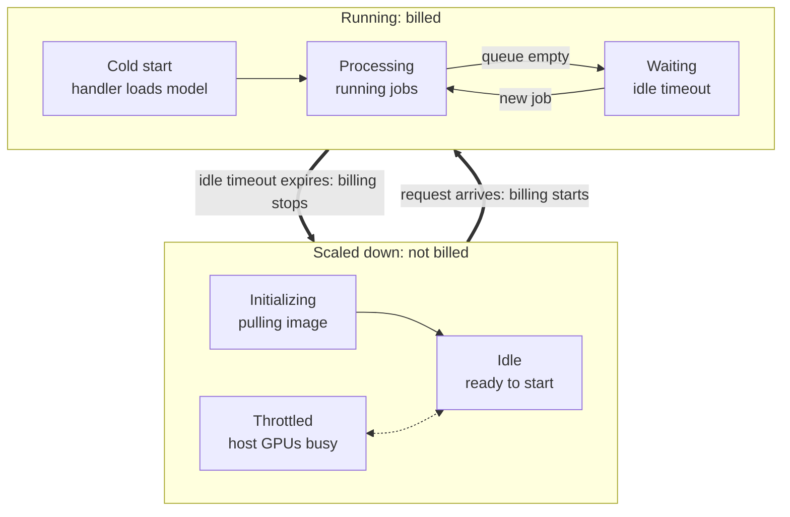

import { MachineTooltip } from "/snippets/tooltips.jsx";

Workers are containerized environments that run your code on Runpod Serverless.

## Deployment workflow

After creating your [handler function](/serverless/workers/handler-functions), package it into a Docker image and deploy it to an endpoint:

<Steps>
  <Step title="Create a Dockerfile">
    Package your handler function and all its dependencies [into a Docker image](/serverless/workers/create-dockerfile).
  </Step>
  <Step title="Deploy to an endpoint">
    Push your image and create an endpoint using one of two methods:
    - [Deploy from Docker Hub](/serverless/workers/deploy): Build locally and push to a container registry.
    - [Deploy from GitHub](/serverless/workers/github-integration): Auto-build and deploy directly from your repository.
  </Step>
</Steps>

## Model deployment

To deploy workers with AI/ML models, follow this order of preference:

1. [**Use cached models**](/serverless/endpoints/model-caching): For models on Hugging Face (public or gated), this is the recommended approach. Cached models provide the fastest cold starts and persist across worker restarts.

2. [**Bake the model into your Docker image**](/serverless/workers/create-dockerfile#including-models-and-files): For private models not on Hugging Face, embed them directly in your container image. This increases image size and initialization time, but ensures the model is stored directly on machine disk before the worker starts, so it's ready to serve requests quickly after billing begins.

3. [**Use network volumes**](/storage/network-volumes): For development workflows or very large models (500GB+), store models on a network volume. Reading from network volume will occur after a worker starts running and billing begins, and will be slower than reading cached or baked models directly from machine disk. However, worker initialization time will be faster, and changes to the underlying image will not require rebuilding and repushing the image with the model artifact, making it faster to iterate during development.

## Worker types

Workers can run in two modes depending on your latency and cost requirements:

- **Active workers** run continuously (24/7) and are always ready to process requests instantly. They eliminate cold starts entirely, making them ideal for latency-sensitive or high-traffic applications.

- **Flex workers** scale dynamically based on demand, scaling down to zero when there are no requests. They incur cold starts when scaling up but cost nothing when not in use, making them ideal for variable or sporadic workloads.

The system may also spin up **extra workers** during traffic spikes when Docker images are cached on hosts (default: 2).

## Worker lifecycle

A worker is always either **scaled down** or **running**. Billing follows that split: a worker is billed only while it is running.

1. **Scaled down**: Runpod prepares workers ahead of time on a host <MachineTooltip /> by pulling your image and downloading [cached models](/serverless/endpoints/model-caching). No container is running for you, so nothing is billed.
2. **Cold start**: When a request needs a worker, Runpod starts one and billing begins. Your container starts and your handler loads its model. The cold start ends when the handler is ready to take its first job.
3. **Processing**: The worker runs jobs from the queue back to back.
4. **Waiting**: When the queue is empty, the worker waits for the next job for up to the [idle timeout](/serverless/endpoints/endpoint-configurations#idle-timeout). It is still running and still billed. A new job during this window starts immediately with no cold start.
5. **Scale down**: If no job arrives before the idle timeout expires, the worker stops and billing stops. With [FlashBoot](/serverless/endpoints/endpoint-configurations#flashboot), Runpod tries to keep the stopped worker in a state that restarts faster.

[Active workers](#worker-types) skip step 5. They stay running, and billed, even when they have no jobs.

<Note>
The console state **Idle** means the worker has shut down and is not billed. The [idle timeout](/serverless/endpoints/endpoint-configurations#idle-timeout), is the period a worker stays running after a job finishes, waiting to pick up the next one. During this period, the worker is still billed and shows as **Running** in the console. 
</Note>

## Worker states

The **Workers** tab shows each worker in one of these states:

| State | Description | Billed |
|-------|-------------|---------|
| **Initializing** | Scaled down. Runpod is pulling the image or downloading cached models on the host. | No |
| **Idle** | Scaled down and ready to start. The image and cached models are on the host. | No |
| **Running** | Started. Covers the cold start, processing jobs, and waiting during the idle timeout. | Yes |
| **Throttled** | Scaled down. The host's GPUs are in use by other workloads, so this worker can't start there right now. | No |
| **Unhealthy** | The worker crashed or failed to initialize. Runpod retries it with increasing delays for up to 7 days. | No |

A worker marked **Outdated** in the version column is running an older version of your endpoint. Runpod replaces it with a worker on the latest version. It is billed while it is running, like any other worker.

Image pulls are normally done while a worker is scaled down. If a worker starts before its image is on the host, the pull happens during the cold start and is billed. See [compute cost breakdown](/serverless/pricing#compute-cost-breakdown).

<Note>
If an endpoint repeatedly produces unhealthy workers, Runpod automatically scales it down; see [My endpoint was scaled down unexpectedly](/serverless/troubleshooting#my-endpoint-was-scaled-down-unexpectedly). 
</Note>

View worker states in the **Workers** tab of your endpoint in the [Runpod console](https://www.console.runpod.io/serverless).

## Max worker limits

Account balance determines your maximum workers (flex + active combined):

| Balance | Max workers |
|---------|-------------|
| Default | 5 |
| \$100+ | 10 |
| \$200+ | 20 |
| \$300+ | 30 |
| \$500+ | 40 |
| \$700+ | 50 |
| \$900+ | 60 |

Need more capacity? [Contact support](https://www.runpod.io/contact).

## Best practices

| Practice | Benefit |
|----------|---------|
| [Optimize image size](/serverless/workers/create-dockerfile) | Faster downloads, reduced cold starts |
| [Use model caching](/serverless/endpoints/model-caching) | Fastest cold starts |
| [Test locally first](/serverless/development/local-testing) | Catch issues before deployment |
| [Use logs and SSH](/serverless/development/logs) | Debug and optimize effectively |
